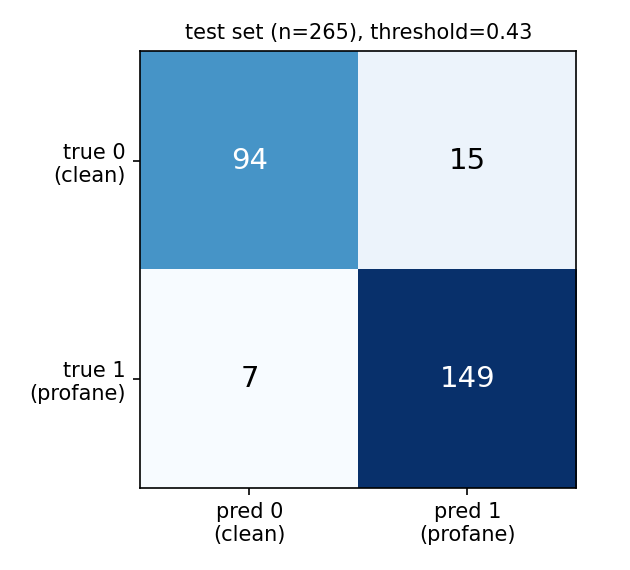

# Kazakh Profanity Detection in Product Reviews

DSSC5113 Bonus Project, Fall 2026. Author: **Zhakhayeva Zhanel**, student ID **25MD0167**.

The model reads one Kazakh review or comment about a product or app and predicts:

| label | meaning |
|---|---|
| **0** | no Kazakh profanity |
| **1** | Kazakh profanity present |

It also returns **P(profane)**, a probability, together with the decision threshold it used.

**Model:** `xlm-roberta-base`, fine-tuned for sequence classification.
**Trained weights:** https://huggingface.co/<your-hf-user>/kazakh-profanity-xlmr (see [Model access](#model-access)).

| Test set (n = 265) | Precision (profane) | Recall (profane) | F1 (profane) | Accuracy |
|---|---|---|---|---|
| XLM-R (this model), threshold 0.43 | **0.909** | **0.955** | **0.931** | 0.917 |

---

## 1. Data

### Source
The file `kazakh_profanity_share.csv` was provided by the instructor and contains 3,061 rows with
columns `kazsandra_id, text, label, split`.
The texts are a subset of **KazSAnDRA**, the Kazakh Sentiment Analysis Dataset of Reviews and Attitudes
(ISSAI; Yeshpanov & Varol, LREC-COLING 2024, <https://huggingface.co/datasets/issai/kazsandra>).
The id prefix tells where each review comes from:

| prefix | source | rows |
|---|---|---|
| `pla` | Google Play reviews of apps and games | 2,724 |
| `kas` | Kaspi.kz product reviews | 183 |
| `gis` / `map` | 2GIS / map reviews of shops and services | 95 |
| `kit` / `fli` | book and film reviews | 59 |

**How this relates to product reviews:** every text is a user review of a product or service: an app,
a game, a Kaspi item, a shop or a book. That is exactly the kind of text a marketplace moderator sees.
The texts are real user writing: there are **no synthetic examples** in the data.

**Access:** the raw file is not committed; see `data/raw/README.md`.
The anonymised, cleaned splits that every script uses **are committed** in `data/processed/`.

### Labeling rules
I used the labels that came with the file and checked them against the rules below
(see [Label audit](#label-audit)).

**Label 1 (profane)** if the comment contains at least one of the following:
* **Kazakh obscene vocabulary:** words such as *қотақ, ам, сік-/сиг-, көт, боқ, шешеңді …* and
  compounds like *қотақбас*.
* **Strong abusive slurs aimed at a person, the developers or the product:** *мал, малски, есек, ешак,
  ақымақ, топас, қатын* (derogatory), *чорт*.
* **Russian mat inside a Kazakh comment:** *бля, нахуй, заебал, пиздец, говно, сука, далбаеб …*
  * Mixed-language rule: Kazakh internet speech code-switches all the time. If a comment is written in
    Kazakh (Cyrillic, Latin or Russian-keyboard spelling) and contains Russian mat, it gets label 1.
* **Masked, abbreviated or misspelled profanity** that a reader still recognises: *қ***қ, з@еб@л, Н*ху,
  бл*ть, шшс / щщс* (= *шешеңді сіг-*), *зб, дп*, Latin *qotaq, zaebal*, letter repeats
  *Қотааааақ*, missing spaces *говногой*.

**Label 0 (clean)** applies to:
* Negative but non-obscene criticism. A negative review is **not** automatically profane:
  *нашар, жаман, өтірік, далбаса* (“sham / nonsense”), *шайтан*.
* Neutral uses of words that look like profanity: *мал шаруашылығы* (livestock farming),
  *телефон көтермейді* (doesn't pick up the phone), *түсік, шешендік* (oratory), *маладес* (= молодец).
* Comments that only **talk about** swearing (“the guard swore at me”) without containing the swear words.
* Profanity that appears only as a substring inside random keyboard-mash letters.

**Ambiguous cases** were left with their original label rather than guessed. Examples are *Амысыки нәрсе*
and the mild insult *ит* (“dog”). These are listed as limitations below.

### Label audit
The labels come from an existing dataset, so I checked that they match these rules.
1. I matched every row against a lexicon of about 90 profane stems.
2. I read every **label-0 row that contained a stem** (157 rows) and every **label-1 row that contained
   none** (246 rows).
3. I changed 19 labels (0.6% of the data). Each change and its reason is in
   `data/label_revisions.csv`, and `prepare_data.py` applies them.

| change | count | examples |
|---|---|---|
| 0 → 1 | 11 | `Қотақ амсын была`, `Қотақбас екен`, `заибал`, `Акымак`, `Малски оиын` |
| 1 → 0 | 8 | a neutral Kaspi bag review, `далбаса` (“sham”), comments that only describe swearing |

Labels were never changed after looking at test-set predictions (see error 1 below).

### Example labelled rows

| text | label |
|---|---|
| Сапасы жақсы.Есіктің ішкі жағы көтеріліп тұр. | 0 |
| Далбаса, жумыс жасай алмайд | 0 (criticism, not profanity) |
| Мал шаруашылығы мен айнасам 1млн аударындар | 0 (livestock, not an insult) |
| Кымбаттап кетипти говно | 1 (Russian mat in a Kazakh review) |
| Мал ойын тартылмайд | 1 (abusive *мал*) |
| Қысқасаын айтқанда к*т приложения екен | 1 (masked *көт*) |
| Qotagymdy jemesh | 1 (Latin transliteration) |

### Cleaning, duplicates and splits (`python -m src.prepare_data`)
1. **Anonymisation.** E-mails, URLs, phone numbers and `@handles` are masked, and so are surnames,
   patronymics and self-introduced names (*Есімім …*, *Атым …*), which become `[NAME]`. This changed 24 rows.
   The source dataset contains no reviewer usernames.
2. **Label revisions** are applied (see above).
3. **Exact duplicates** are removed after aggressive normalisation: lower-case, punctuation and emoji
   dropped, repeated letters and words collapsed. This removed 11 rows.
4. **Near-duplicates** are grouped. Rows whose character 3–5-gram TF-IDF cosine similarity is ≥ 0.9 go
   into one group, using union-find. This found 14 groups covering 31 rows, e.g.
   `Қотақ ойын сука ам` and `Қотақ сука ам`.
   This TF-IDF is only a de-duplication tool and is never used as a model feature.
5. **Splits.** I kept the split column from the instructor's file but **repaired leakage**: each
   near-duplicate group is moved into its majority split, which moved 6 rows. The script asserts that
   no group spans two splits.
   * `--resplit` instead creates a fresh stratified group split (80/10/10).

**Random seed: 42.** The full report is in `data/processed/split_report.json`.

| split | n | clean (0) | profane (1) | profane share |
|---|---|---|---|---|
| train | 2,520 | 1,299 | 1,221 | 48.5% |
| val | 265 | 109 | 156 | 58.9% |
| test | 265 | 109 | 156 | 58.9% |
| **total** | **3,050** | 1,517 | 1,533 | |

---

## 2. Model

### Why XLM-RoBERTa-base
* **Language coverage.** It is a multilingual transformer (278M parameters) pre-trained on 100 languages,
  **including Kazakh and Russian**, which matches code-switched Kazakh–Russian reviews.
  The KazSAnDRA authors also used XLM-R as a baseline on these same reviews.
* **Spelling noise.** Its SentencePiece tokenizer splits any string into sub-word pieces, so misspellings,
  Latin-script Kazakh and masked words never become “out of vocabulary”.
* **Size.** With 2.5k labelled examples, fine-tuning a pre-trained model is much more data-efficient
  than training a transformer from scratch.

### From raw text to prediction
Trace for `"Қотааааақбас ойын!!"`:
1. `normalize()` in `src/text_utils.py` applies NFKC unicode normalisation, lower-cases the text,
   collapses runs of 4+ identical characters to 3 and squeezes whitespace. The result is
   `қотааақбас ойын!!`.
   * Punctuation, emoji and `* @ #` are kept on purpose: `қ***қ` and `з@еб@л` are masked profanity.
2. The XLM-R tokenizer turns the text into sub-word pieces: `▁қо та а ақ бас ▁ойын !!`. These become
   ids, with `<s> … </s>` added.
   * Unknown words are split into known pieces; a symbol with no piece at all becomes `<unk>`.
   * The tokenizer is pre-trained and never re-fitted, so nothing is learned from val or test.
3. The 12-layer encoder takes the `<s>` vector, and the classification head (dense → tanh → linear)
   produces 2 logits. Softmax turns them into **P(profane)**.
4. If P(profane) ≥ **0.43** (the threshold tuned on validation), the label is **1**.

### Long comments
98% of comments fit in 128 tokens. Longer comments are split into **overlapping windows of 128 tokens
with a stride of 64**, and the comment gets the **maximum** window probability: one profane window is
enough to flag it. Training truncates to 128 tokens, which affects about 2% of the training texts.

### Training settings (`config.json`)
| setting | value |
|---|---|
| objective | cross-entropy over 2 classes |
| optimizer | AdamW, lr **3e-5**, weight decay 0.01 (none on bias/LayerNorm) |
| schedule | linear decay with 10% warm-up; gradient clipping at 1.0 |
| batch size / max length | 16 / 128 tokens (dynamic padding) |
| epochs | up to 6, early stopping with patience 2 on val F1 |
| frozen | the word-embedding matrix (192M of 278M parameters), see below |
| trainable | 86M parameters: all 12 transformer layers plus the head |
| seed | 42 (Python, NumPy, torch and the DataLoader shuffle) |
| hardware | Apple M5 (MPS), about 65 s per epoch |

**Why the embeddings are frozen.** A full fine-tune did not fit in 16 GB of RAM: the gradients and Adam
state for the 250k×768 embedding matrix pushed the machine into swap, and one epoch took over 2 hours.
Freezing that matrix cut the run to about 7 minutes. With only 2.5k texts it also limits overfitting:
the model keeps the pre-trained embeddings for words it never sees in training.

### Model selection (validation data only)
* **Epoch.** The checkpoint with the best validation F1 is kept.
* **Learning rate.** A small sweep chose 3e-5. Logs are in `results/lr_sweep/`.

  | lr | best epoch | val F1 @0.5 | val F1 @tuned threshold |
  |---|---|---|---|
  | 2e-5 | 5 | 0.915 | 0.922 |
  | **3e-5** | **4** | **0.930** | **0.937 (thr 0.43)** |
  | 5e-5 | 5 | 0.927 | 0.931 |

* **Threshold.** It is chosen to maximise validation F1 for the profane class, searched only in
  [0.20, 0.80]. An earlier unrestricted search picked 0.08, which was fitted to 2–3 borderline validation
  texts out of 265.

Training curve for the chosen run (`results/training_log.csv`): validation loss is lowest at epoch 3 and
rises afterwards while F1 stays flat. The model becomes over-confident on its mistakes, which is why
early stopping and best-epoch selection are used.

| epoch | train loss | val loss | val F1 @0.5 |
|---|---|---|---|
| 1 | 0.618 | 0.796 | 0.658 |
| 2 | 0.380 | 0.269 | 0.907 |
| 3 | 0.245 | 0.236 | 0.925 |
| **4** | 0.172 | 0.367 | **0.930** |
| 5 | 0.106 | 0.469 | 0.926 |
| 6 | 0.084 | 0.530 | 0.926 |

---

## 3. Results on the held-out test set
The test set was used **once**, after the epoch, learning rate and threshold were fixed
(`python -m src.evaluate`). Output files:
* `results/test_metrics.json`
* `results/confusion_matrix_test.png`
* `results/test_predictions.csv`
* `results/test_errors.csv`

**n = 265** (109 clean, 156 profane), threshold 0.43:

| metric (profane class) | value |
|---|---|
| Precision | 0.909 |
| Recall | 0.955 |
| F1 | **0.931** |
| Accuracy / macro-F1 | 0.917 / 0.913 |



|  | predicted 0 | predicted 1 |
|---|---|---|
| **true 0** | TN = 94 | **FP = 15** |
| **true 1** | **FN = 7** | TP = 149 |

At the default threshold of 0.5 the result is almost identical: F1 0.928 with one more FN.

**Reference only.** A character 2–5-gram TF-IDF + logistic regression baseline (`python -m src.baseline`,
fitted on train only) gets val F1 0.947 / test F1 0.911.
* With n = 265, one error moves F1 by about 0.3 points, so the gap between the two models is small.
* XLM-R is better on test but slightly worse on val; the honest conclusion is that profanity is largely
  a lexical task.
* XLM-R's advantage is that it uses context, e.g. it correctly predicts clean for *Телефон көтермейді*
  and *Мал шаруашылығына арналған*.

### What the errors mean for moderation
* **False positive:** a clean review is flagged as profane. For a marketplace this means a legitimate,
  often negative, customer opinion gets hidden or delayed. That hurts users and the platform's
  credibility, especially when the review is a valid complaint.
* **False negative:** a profane review gets published. Customers see obscene language on a product page,
  which damages the brand.
* **Which matters more:** for automatic removal, FPs matter most, because silently deleting honest
  complaints is worse. For a **“send to human moderator” queue**, high recall matters more, and our
  operating point (recall 0.955, precision 0.909) suits that use. The threshold can be moved to trade
  one for the other.

### Error analysis (all 22 errors are in `results/test_errors.csv`)
1. **`Ңғ табыс етті мал шаруашылығын қарқынды`**: FN, p = 0.001.
   * The text is about *livestock farming*. By our rules it is clean, so this is a **label error in the
     test set**: the model is right and the gold label is wrong.
   * I did not fix it, because changing test labels after seeing predictions would bias the evaluation.
   * Fix: a second annotator pass on the whole dataset, not only on lexicon hits.
2. **`Күшті амы шыккан ойын`**: FN, p = 0.001.
   * The vulgar idiom *амы шыққан* is used as **praise** (“an insanely good game”).
   * The training data almost always pairs obscene words with negative sentiment, so a positive context
     pushed the model to predict clean. The same problem appears in `Маған ұнайды бляя😎`.
   * Fix: add positive-sentiment profane examples, for example by mining KazSAnDRA 5-star reviews
     with a lexicon.
3. **`…ЛАТИННИЦАНЫ "нахуй" алып тастаңдаршы…`**: FN, p = 0.001.
   * A long, polite, well-written request with one quoted Russian obscenity. The polite context
     outweighs a single token.
   * Similar: `говногой` (Russian mat glued to the Kazakh particle *ғой*) and `малар` (misspelled
     *малдар*), where unusual spellings are split into unfamiliar sub-words.
   * Fix: spelling-variant augmentation (glue particles, drop letters, Latin↔Cyrillic) and a lexicon
     feature combined with the model score.
4. **`Шайтан кошмар`, `Вапше қызық емес`, `Ешкашан`, `Қазақша жоқққ`**: FP, p > 0.97.
   * These are short **negative** reviews with no profanity: the model partly learned
     “short and angry → profane”. This is a dataset bias.
   * In train, 58% of texts under 30 characters are profane, against 42% of longer texts.
   * Fix: add more short negative-but-clean reviews; KazSAnDRA has many 1-star reviews to draw from.
5. **`Ай малдес топқой`** (*маладес* = “well done”), **`Осы Амонг астан…`** (*Among Us* contains *ам*),
   **`akbo*** екі шетінде галочка`** (asterisk-masked brand name): FP.
   * These are **surface look-alikes**: sub-words like *мал*, *ам* and `***` are strong profanity cues.
   * Fix: targeted counter-examples of the same look-alikes in a clean context.

### Limitations
* Small data: 2.5k training texts and 265 test texts. A bootstrap 95% CI for test F1 is **0.899–0.958**.
* The label audit was lexicon-guided, so errors in rows without suspicious words, like error 1 above,
  were not reviewed. One person did the labelling decisions, so there is no inter-annotator agreement.
* The data is mostly Google Play game and app reviews (89%). Marketplace reviews (Kaspi) are rare: 183 rows,
  of which only 1 is profane, so performance on real product-review traffic may differ.
* Mild insults such as *ит, жынды, чорт* follow the existing dataset conventions; another moderator
  policy might label them differently.
* MPS/GPU training is not bit-wise deterministic even with a fixed seed, so a re-run can give slightly
  different numbers.

---

## 4. How to run

### Setup
```bash
git clone https://github.com/<your-github-user>/kazakh-profanity-detection.git
cd kazakh-profanity-detection
python -m venv .venv && source .venv/bin/activate      # Python 3.10+ (developed on 3.13)
pip install -r requirements.txt
```
**Colab:** open `notebooks/colab_demo.ipynb`, set `REPO_URL` and `HF_MODEL_ID`, and run all cells.
It works in a fresh runtime.

### Predict with the trained model (no retraining)
```bash
python -m src.predict "Өте керемет ойын, ұнады!" "Қотақбас ойын екен" --model <your-hf-user>/kazakh-profanity-xlmr
python -m src.predict --model <your-hf-user>/kazakh-profanity-xlmr    # interactive: type comments
```
```python
from src.predict import Predictor
clf = Predictor("<your-hf-user>/kazakh-profanity-xlmr")   # or "artifacts/model"
clf("Мал ойын тартылмайды")
# {'text': 'Мал ойын тартылмайды', 'label': 1, 'prob_profane': 0.999, 'threshold': 0.43}
```
Sample outputs:
```
0 (clean  )  P(profane)=0.000 | Жарнама тым көп, ойын нашар, қатып қала береді
0 (clean  )  P(profane)=0.002 | Телефон көтермейді
0 (clean  )  P(profane)=0.001 | Мал шаруашылығына арналған жақсы қосымша
1 (PROFANE)  P(profane)=0.999 | Қотақбас ойын екен
1 (PROFANE)  P(profane)=0.999 | qotaq oiyn
```

### Reproduce the whole pipeline
```bash
python -m src.prepare_data   # optional: rebuilds data/processed from data/raw (needs the raw CSV)
python -m src.train          # about 7 min on Apple M5; a few minutes on a Colab GPU → artifacts/model
python -m src.evaluate       # one test-set evaluation → results/
python -m src.baseline       # optional reference model
```
| file | role |
|---|---|
| `src/text_utils.py` | anonymisation, normalisation, duplicate key |
| `src/prepare_data.py` | cleaning, label revisions, de-duplication, leak-free splits |
| `src/train.py` | fine-tuning loop, best-epoch selection, threshold tuning |
| `src/model_utils.py` | seeding, device, loading, sliding-window prediction |
| `src/metrics.py` | precision/recall/F1/confusion matrix, threshold search |
| `src/evaluate.py` | test evaluation, confusion-matrix plot, error dump |
| `src/predict.py` | CLI and Python API for new comments |
| `src/tune_threshold.py` | re-select the threshold on val without retraining |
| `config.json` | every hyper-parameter and the seed |

### Model access
The fine-tuned weights (1.1 GB) are too large for GitHub and are hosted on the Hugging Face Hub:
**https://huggingface.co/<your-hf-user>/kazakh-profanity-xlmr**.
The repo contains the weights, the tokenizer files and `inference_config.json` (threshold 0.43, window
128/64), so `Predictor("<hub id>")` works directly.

To upload your own copy after training:
```bash
hf auth login                       # paste a WRITE token; never commit it
hf upload <your-hf-user>/kazakh-profanity-xlmr artifacts/model .
```

---

## Acknowledgement of assistance
* **AI assistance.** The code structure, the label audit and parts of this README were drafted with an
  AI assistant (Claude).
* **My own contributions:** <describe: e.g. checking every label revision, choosing the labelling rules,
  running the training and evaluation, reviewing the error analysis>.
* I have read and understand all submitted code.
* **Dataset:** KazSAnDRA (ISSAI, Nazarbayev University), subset provided by the course instructor.
* **Model:** `FacebookAI/xlm-roberta-base` (Conneau et al., 2020).
